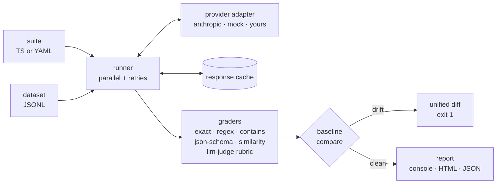

# promptslay

[](https://github.com/adeen-s/promptslay/actions/workflows/ci.yml)
[](LICENSE)
[](package.json)

**Unit tests for your prompts.** A prompt regression & evaluation framework: define eval suites in TypeScript or YAML, grade outputs with deterministic checks and LLM judges, snapshot baselines, and fail CI when a prompt or model change makes things worse.

```text
offline-demo (mock · claude-haiku-4-5)

CASE          STATUS  SCORE  COST      LATENCY  DRIFT
inline-case   ✓ pass  1.00   <$0.0001  1ms      —
q-ada         ✓ pass  1.00   <$0.0001  1ms      —
q-json        ✓ pass  1.00   <$0.0001  1ms      —
q-similarity  ✓ pass  0.98   $0.0001   1ms      —

4/4 passed (100%) · cost $0.0004 · cache hits 0/4
```

## Why

Prompts are code with no compiler. Editing one word, swapping models, or bumping an SDK can silently change behavior in production. `promptslay` gives prompts the same safety net code has: versioned test suites, assertions, committed baselines, and a CI gate that turns "the bot feels worse" into a red build with a diff.

## How it works



## Quickstart

```bash
npm i -D promptslay
npx promptslay init          # scaffolds promptslay.suite.yaml
npx promptslay run promptslay.suite.yaml
```

The scaffolded suite uses the offline `mock` provider, so you can try the full workflow without an API key. For real evals set `provider: anthropic` and export `ANTHROPIC_API_KEY` (see `.env.example`).

### A suite in YAML

```yaml
name: summarizer
provider: anthropic
model: claude-opus-4-8          # default; use claude-haiku-4-5 for cheap smoke runs

prompt:
  system: You summarize text in exactly two sentences.
  user: "Summarize this:\n\n{{article}}"

dataset: data/articles.jsonl    # one {"id", "vars", "assertions"?} per line

cases:
  - id: mcp-article
    vars: { article: "MCP is an open standard..." }
    assertions:
      - type: contains
        value: MCP
      - type: llm-judge
        quick: true             # judge on the fast tier
        rubric:
          - { name: faithful, description: No claims absent from the source., weight: 2 }
          - { name: concise,  description: At most two sentences. }
```

### The same suite in TypeScript

```ts
import { defineSuite } from 'promptslay';

export default defineSuite({
  name: 'summarizer',
  model: 'claude-opus-4-8',
  prompt: { system: '...', user: 'Summarize this:\n\n{{article}}' },
  cases: [/* ... */],
});
```

See [`examples/`](examples) for complete runnable suites.

## Graders

| Type | What it checks |
|---|---|
| `exact` | Output equals `value` (or the case's `expected`); optional trim/case-folding |
| `contains` | Output contains a substring |
| `regex` | Output matches a pattern |
| `json-schema` | Output parses as JSON and validates against a JSON Schema (ajv) |
| `similarity` | Cosine similarity above a threshold — char-n-gram fallback built in, pluggable embedding providers |
| `llm-judge` | A judge model scores the output against a weighted rubric (1–5 per criterion) and returns a structured verdict |

The judge defaults to `claude-opus-4-8`; set `quick: true` to use the cheap/fast tier (`claude-haiku-4-5`) or pin any model with `judgeModel`. Deterministic graders cost nothing; judge spend is tracked per case in the report.

## Regression testing

```bash
promptslay run suites/ --update-baselines   # record today's outputs
git add .promptslay/baselines && git commit # baselines are meant to be committed
# ...later: change the prompt, bump the model, upgrade the SDK...
promptslay run suites/ --fail-on-regression # exits 1 + unified diff on drift
```

Baselines store each case's output plus a hash of the rendered prompt and model, so the report tells you *why* something drifted: the model got nondeterministic, or you actually changed the prompt.

## CI integration

```yaml
- uses: adeen-s/promptslay@main
  with:
    suites: suites/summarizer.suite.yaml
    fail-on-regression: "true"
    anthropic-api-key: ${{ secrets.ANTHROPIC_API_KEY }}
```

Or plain npm: `npx promptslay run suites/ --fail-on-regression --reporter console,html` and upload `promptslay-report/` as an artifact. The HTML report is a single self-contained file with per-case pass/fail, scores, diffs, and a cost breakdown.

## Cost, latency, caching, parallelism

Every run tracks token usage, estimated cost (per-model pricing table) and latency per case and in aggregate. Cases run in parallel (`--concurrency`, default 4) with exponential-backoff retries on transient provider errors. Responses are cached on disk keyed by `(provider, model, rendered prompt, params)` — re-running an unchanged suite is free and instant; bypass with `--no-cache`.

## Providers

Anthropic (the official `@anthropic-ai/sdk`) is the default. Adding a provider is one interface:

```ts
import { registerProvider, type ProviderAdapter } from 'promptslay';

class MyProvider implements ProviderAdapter {
  readonly name = 'my-llm';
  async generate(prompt, options) {
    // call your API; return { text, usage, latencyMs, costUsd, model }
  }
}

registerProvider('my-llm', () => new MyProvider());
// YAML suites can now say: provider: my-llm
```

The bundled `mock` provider is deterministic and offline — use it to test the harness itself, in CI smoke jobs, or as a template.

## CLI

```text
promptslay run <suites...>  [--fail-on-regression] [--update-baselines]
                            [--reporter console,html,json] [-o dir]
                            [--concurrency n] [--no-cache]
promptslay init             scaffold a starter suite
promptslay report [run]     re-render the HTML report from a saved run
```

## Development

```bash
npm ci
npm run lint && npm run typecheck && npm test   # 113 offline tests, no API key needed
npm run build
node dist/cli/index.js run examples/offline.suite.yaml
```

## License

[MIT](LICENSE) © [Adeen Shukla](https://github.com/adeen-s)
